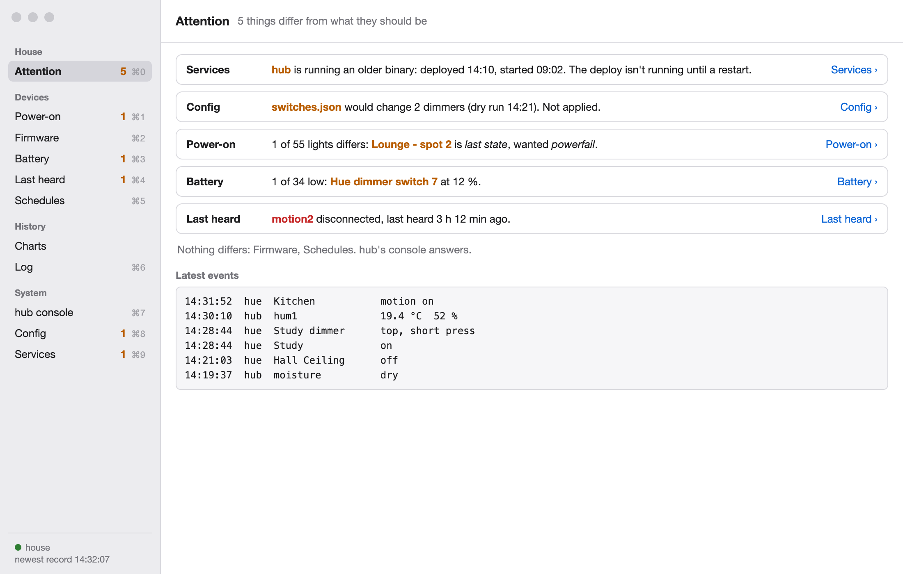
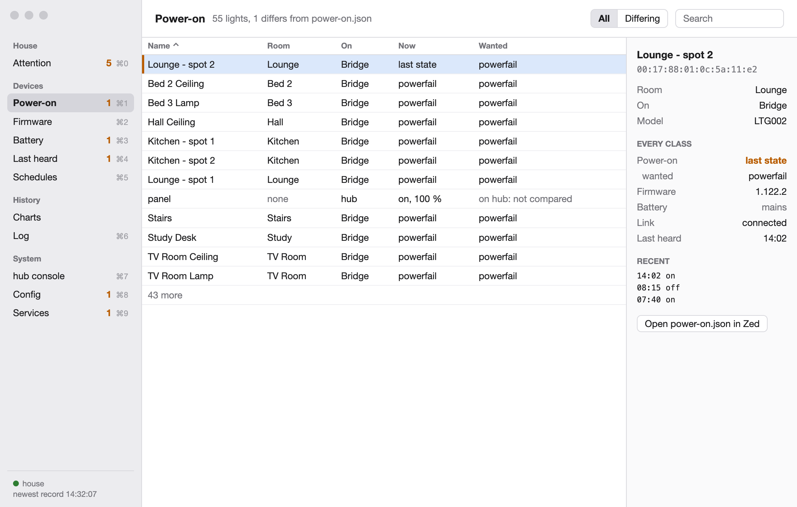
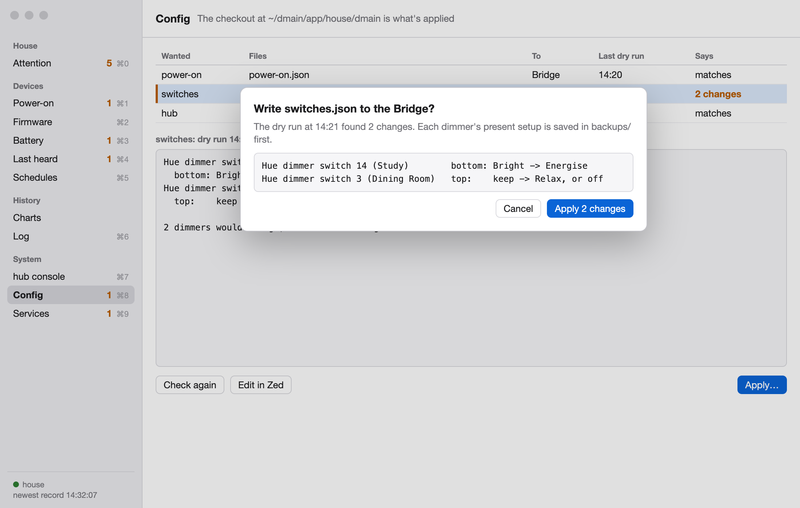
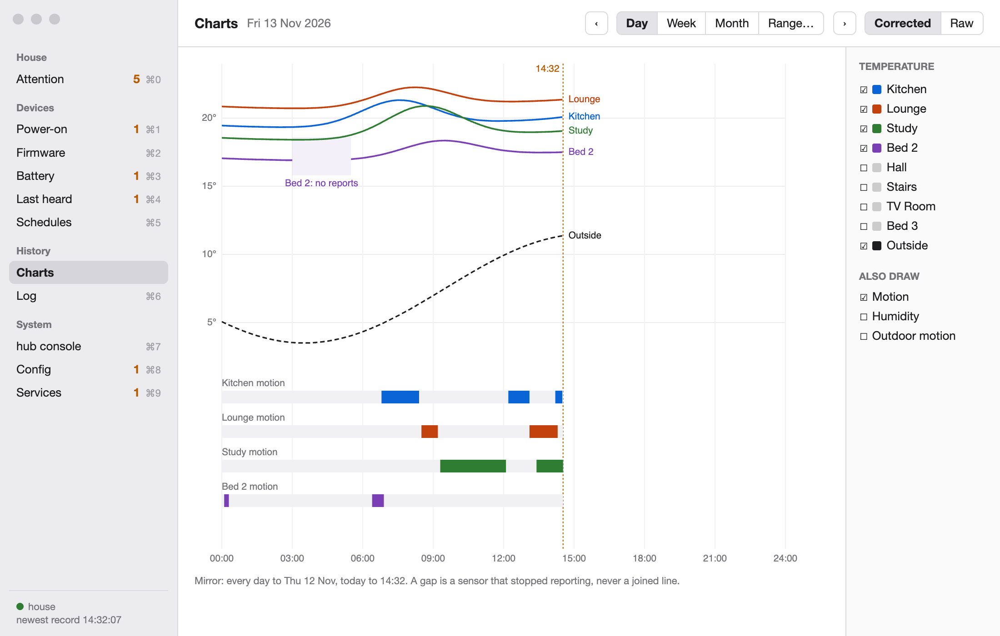
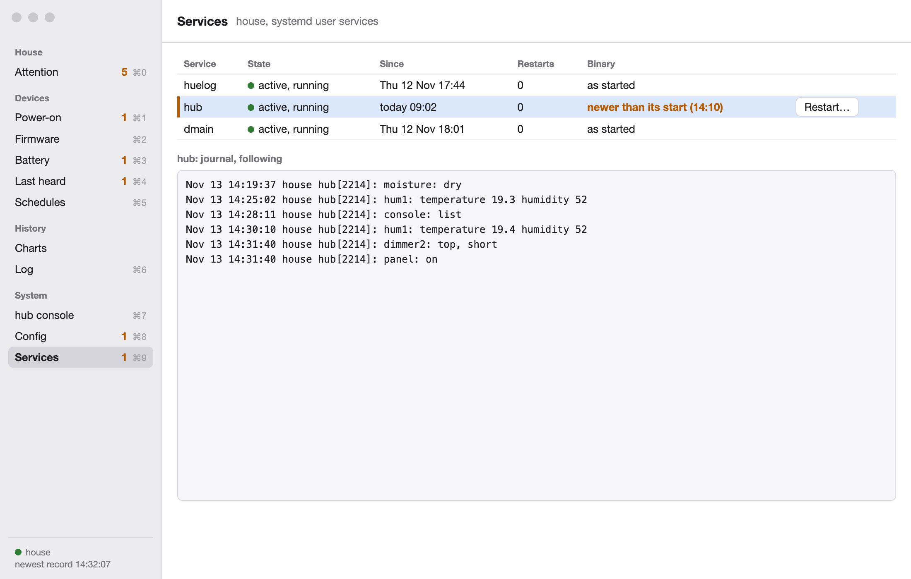
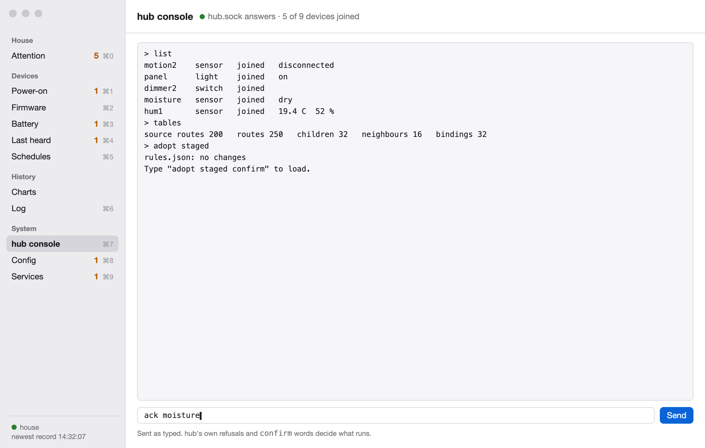

# dmain

**dmain** (from domain/demesne) is a local-only home automation system for a single house. It is written in Zig 0.17 with a macOS management app. Dmain does three things:
- creates and manages a vendor neutral Zigbee network using a ZBT-2 radio (or similar hardware)
- interfaces to a Philips Hue Bridge, so that devices the Bridge can't handle work alongside the Hue lights and switches. 
- provides a macOS app to configure and monitor the system from the desktop, keeping the Bridge's own setup consistent from a single file describing the house.

The primary motivation is to provide a way of extending a Hue system to include devices that are not available (e.g. humidity) and, optionally, to support a gradual migration of devices from an increasingly cloud-based, closed platform to a local, open source platform. 

A secondary motivation was to provide desktop configuration and management and avoid using the (IMHO) over-stuffed Hue app. Obviously, this would not be possible without the truly excellent support that Philips provides for its open API.

<p align="center">
  <a href="app/house/admin/docs/attention.png"></a>
  <br>
  <sub><b>Attention</b>, the admin app's home screen: what differs from what it should be, one line each, and the latest events from both networks. <a href="#the-admin-app">more below</a>.</sub>
</p>

## Things to know before reading further
- **It is functionally specific, not a general platform.** A core design aim was to work directly with specific devices for a small range of functions (light, motion, humidity, temperature, socket switching). There are no adaptors or abstractions for devices it doesn't have (xkcd 927, obviously). Treat it as a worked example to adapt and build-on, not as a black-box platform to install (if you are looking for a ready-made, local, easy to use platform with **vast** compatibility reach, then try the Home Assistant ecosystem).
- **The configuration in this repository is a real house's.** Rooms, device names, addresses and schedules are published as they are, because they are the clearest example of what the files hold. Replace them with your own.
- **The code has been written with the help of AI.** If that rules it out for you, then I respect your dedication to the craft and wish you well.

## What is here

| Path | What it is |
|---|---|
| `app/house/hub` | The Zigbee coordinator: owns an EZSP radio, its device table, rules, groups, schedules, a LAN web page and a terminal console |
| `app/house/huelog` | Follows the Hue Bridge's event stream and writes it to the house log |
| `app/house/dmain` | Combines both logs into the state of each room. It serves the phone pages, writes switch, sensor, schedule and power-on setups to the Bridge from `rooms.json`, and runs an admin console locally or over ssh |
| `app/house/admin` | A macOS admin app (SwiftUI) that draws what `dmain admin <server> --json` reports |
| `app/house/deploy.sh` | Builds a program for a server over ssh, installs its systemd user unit and checks that it stayed up |
| `lib/zigbee` | EZSP and ASH framing, ZCL, and the serial link with its recovery |
| `lib/hue` | The Hue local API v2: resources, the event stream, writes, and TLS that verifies the Bridge's certificate |
| `lib/houselog` | The house log: one record format for both networks, keyed by IEEE address |
| `lib/httpd` | The small LAN HTTP server that hub and dmain share |
| `lib/tui` | Terminal screen layout and drawing |
| `lib/util` | Host helpers: local time, serial ports, raw terminals, JSON access, files with one per day |

Each package builds and tests on its own (`cd lib/hue && zig build test`). The root `build.zig` runs them all.

## The admin app

One window: a sidebar of screens, each with ⌘-digit shortcuts, and a count of the rows that differ on each one. Orange means a row differs from what it should be and red means something is broken. A row that matches stays plain. The app only draws: every row, mark and dry run comes from `dmain admin <server> --json`.

Click an image for full size.

<table>
  <tr>
    <td width="50%" valign="top">
      <a href="app/house/admin/docs/power-on.png"></a>
      <br><sub><b>Power-on</b>: one setting across every device, differing rows first. The inspector shows one device across every class.</sub>
    </td>
    <td width="50%" valign="top">
      <a href="app/house/admin/docs/config.png"></a>
      <br><sub><b>Config</b>: each wanted file is dry-run against the house. Apply shows the changes again before anything is written.</sub>
    </td>
  </tr>
  <tr>
    <td colspan="2">
      <a href="app/house/admin/docs/charts.png"></a>
      <br><sub><b>Charts</b>: temperature per room against Outside, with motion on the same time axis. A gap where a sensor stopped reporting is drawn as a gap. History is folded from a local mirror of the house logs, so it works offline.</sub>
    </td>
  </tr>
  <tr>
    <td width="50%" valign="top">
      <a href="app/house/admin/docs/services.png"></a>
      <br><sub><b>Services</b>: systemd's state for each program, a flag when a deployed binary isn't running yet, its journal, and Restart.</sub>
    </td>
    <td width="50%" valign="top">
      <a href="app/house/admin/docs/hub-console.png"></a>
      <br><sub><b>hub console</b>: the Zigbee coordinator's own console, sent as typed. hub's <code>confirm</code> words guard what runs.</sub>
    </td>
  </tr>
</table>

## Rules the design keeps

- **Buttons act at once.** There are no timed, dual-purpose buttons, and every wall dimmer in the house has the same layout.
- **State is shown only when a device reports it.** Commands are never optimistic, and data from a source that has gone quiet is marked stale.
- **One source of truth for each kind of fact.** Each room's lights, scenes, controls and schedules live in `rooms.json`, and the Bridge's own setup is generated from it, so nothing has to be kept consistent by hand.
- **Failing means reverting.** Any control dmain takes over must expire or lapse if dmain stops.
- **Local only.** Nothing is reachable from outside the LAN, and nothing needs a cloud account.

## What you need

- **Zig 0.17.0.**
- **A Hue Bridge or Bridge Pro.** It offers only TLS 1.2 with ECDHE-ECDSA, which Zig's standard TLS client doesn't. `lib/hue` patches the standard library's client at build time to add that suite, so the patch follows whichever compiler you build with.
- **An EZSP Zigbee radio** for hub, such as the Home Assistant Connect ZBT-2.
- **A Linux server** to run the programs, either x86-64 or 32-bit ARM. A Raspberry Pi 3 is enough. The programs also build and run on macOS.
- **macOS 15** for the admin app.

## Getting started

```bash
zig build test          # every package's host tests
zig build check         # typecheck everything, for both Linux targets as well
zig build list          # the packages and what each supports
```

### Secrets

Two kinds of file hold secrets. Both are gitignored, both are made on the server, and `deploy.sh` never copies or prints them.

- **`bridge.json` and `huelog.json`** hold the Bridge's application key. Create the key with the Bridge's link button, as described in Hue's developer documentation. `app/house/huelog/huelog.example.json` shows the format. hub's `bridge.json` is the same `bridge` object on its own, and dmain reads hub's copy.
- **`hub-coordinator.json`** holds the Zigbee network key and the coordinator's saved state. hub writes it when it forms or resumes a network and rewrites it every hour. Keep a copy somewhere safe: without it, a replacement radio can't take over the network.

### Your hosts

- **The server.** `deploy.sh` and `dmain admin` take an ssh name, so add your server to `~/.ssh/config`. `huelog/tools/pull.sh` and the admin app default to an alias called `house`. Change the app's setting with `defaults write local.zig.dmain-admin host <name>`.
- **The checkout.** The admin app expects `~/dmain/app/house/dmain`. Change it with `defaults write local.zig.dmain-admin checkout <path>`. The launchd plists in `deploy/` have `YOU` where your user name goes.
- **The radio.** hub's default port is the radio this house uses, by USB serial number, in `DEFAULT_DEVICE_PATH` in `app/house/hub/src/main.zig`. Pass your own as the first argument, or change the default. On Linux, use the `/dev/serial/by-id/` link, not `ttyACM<n>`: a replug can renumber the radio, and recovery reopens the same path. `deploy/hub.service` names the same device.
- **On Fedora, mask ModemManager before you plug the radio in.** It probes new serial ports with AT commands and corrupts the EZSP handshake, which looks exactly like a wrong baud rate.

### Deploying

```bash
app/house/deploy.sh <ssh name> hub
app/house/deploy.sh <ssh name> huelog
app/house/deploy.sh <ssh name> dmain
```

Each program reads its configuration from its own directory on the server (`~/hub`, `~/huelog`, `~/dmain`). Started from the wrong directory, a program comes up with no names and no rules; it doesn't refuse to start. Tracked configuration is copied only to a server that has none, unless you pass `--config`, because hub changes its running configuration through `adopt`.


## Licence

MIT; see `LICENSE`. Hue is a trademark of Signify. This project is not affiliated with Philips, Signify, Nabu Casa or Silicon Labs.
